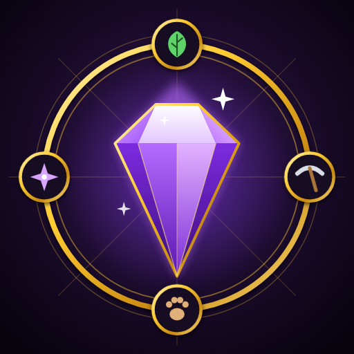
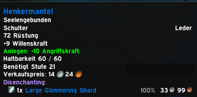
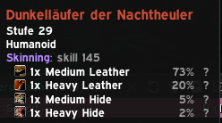
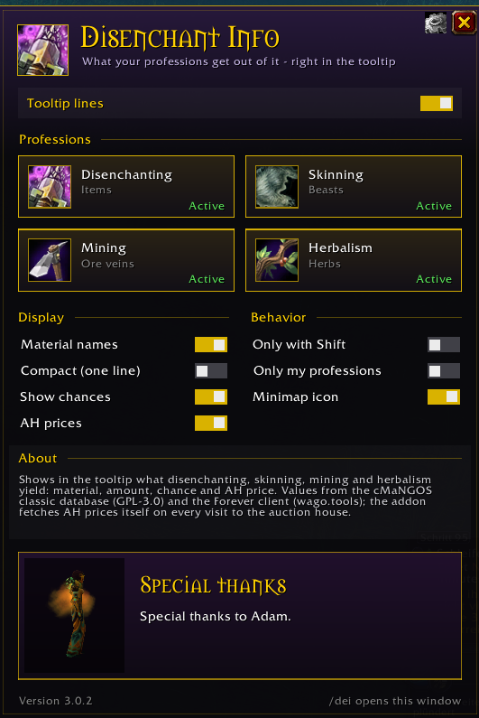
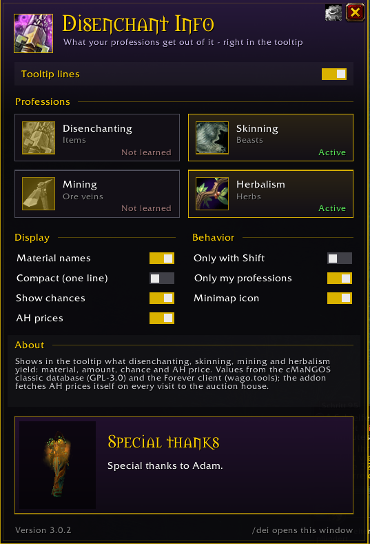

  

<h1 align="center">Disenchant Info</h1>

  <b>Know what you get before you click.</b> 
  A WoW Forever addon: hover an item, a beast, an ore vein or a herb and the tooltip shows
  what your profession turns it into – materials, chances, amounts and auction house prices.

  <a href="https://github.com/majouli/DisenchantInfo/releases/latest">Download</a> ·
  <a href="#install">Install</a> ·
  <a href="#features">Features</a>

| Hover over …                        | Profession    |
|-------------------------------------|---------------|
| an item you can disenchant          | Disenchanting |
| a beast – alive or a corpse to skin | Skinning      |
| an ore vein                         | Mining        |
| a herb                              | Herbalism     |

  
  &nbsp;
  

## Features

- **Disenchanting** – dust, essences, shards and crystals an item can give, with chance and amount.
- **Skinning** – leathers, hides and scales of a beast or its corpse, plus the skill it needs.
  Creatures added in WoW Forever get an estimate from beasts of their level.
- **Mining** – ore, stones and gems per vein, the skill it needs and how often it can be mined.
- **Herbalism** – the herb, its bonus herbs and the skill it needs.
- **Auction house prices, automatic** – every time you open the auction house the addon quietly
  looks up all materials. When you search yourself, it pauses. A single bait listing does not set the price.
- **Only your professions** – by default the tooltip shows the professions your character has learned.
- **Five languages** – English, Deutsch, Français, Español, Русский, or automatic.

  
  &nbsp;
  

## Install

**WowUp:** Get Addons → Install from URL → `https://github.com/majouli/DisenchantInfo`

**By hand:** download `DisenchantInfo-<version>-forever.zip` from the
[latest release](https://github.com/majouli/DisenchantInfo/releases/latest) and unpack it into
`World of Warcraft\_forever_\Interface\AddOns\`.

## Usage

- `/dei` or left-click the minimap icon – settings window
- Right-click the minimap icon – all tooltip lines on / off
- Options: material names, compact one-line view, chances, AH prices, only with Shift

## Data

- Loot, chances and amounts: [cMaNGOS classic-db](https://github.com/cmangos/classic-db) (GPL-3.0)
- Skill requirements and item names: tables of the WoW Forever client via [wago.tools](https://wago.tools)
- Disenchanting: Classic rules by required level, quality and item type

Values are reference values from the Classic loot tables – WoW Forever may differ in places.

## License

[GPL-3.0](LICENSE.txt)

A special thanks to Adam.
